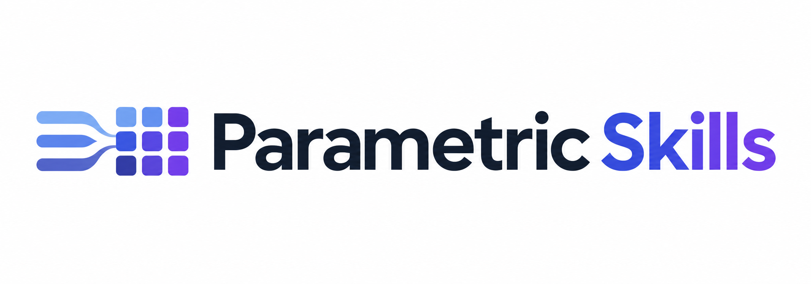
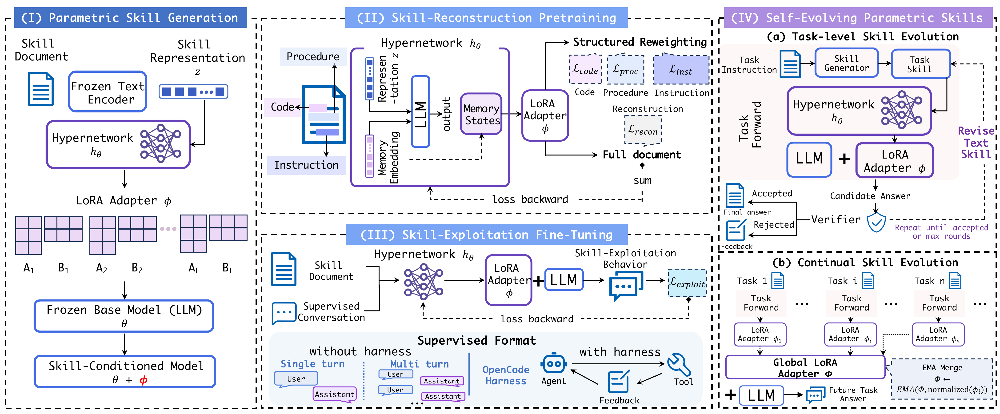

<h1 align="center">
  
</h1>

  <strong>Encoding textual skills into LoRA adapters for large language models</strong>

  <strong>Xuan Zhao*, Haonan He*†, Qingyu Yang*, Minglei Li, Zelin Tan, 
  Bo Wan, Jingqi Ye, Chen Zhang, Shuyue Hu, Peng Ye‡</strong>

  * Equal contribution &nbsp;·&nbsp; † Project lead &nbsp;·&nbsp; ‡ Corresponding author

  
  

  Contact: <a href="mailto:yepeng@pjlab.org.cn">yepeng@pjlab.org.cn</a>

ParametricSkills encodes a textual skill into a LoRA adapter for a large language model (LLM). The adapter enables the model to apply the skill through its parameters, without explicitly including the skill text in the task context.

## Framework overview

The figure summarizes the framework described in the paper:

1. **Parametric skill generation:** A frozen text encoder represents a textual skill, and a hypernetwork maps that representation to a LoRA adapter for a frozen base LLM.
2. **Skill-reconstruction pretraining:** Stage 1 trains the hypernetwork through skill-document reconstruction, with structured reweighting for instructions, procedures, and code.
3. **Skill-exploitation fine-tuning:** Stage 2 uses single- and multi-turn skill-use examples without a coding-agent harness. Stage 3 aligns the model on OpenCode trajectories with a harness.
4. **Self-evolving parametric skills:** Verifier feedback guides task-level skill revision. Adapters generated from successful tasks are normalized and merged into a global adapter through an exponential moving average (EMA) for continual skill evolution.

## Released resources

This GitHub repository hosts the project overview and paper figure. The current release on Hugging Face includes:

- Model components for Qwen3.5-4B and Qwen3.5-9B.
- SkillEval inference and evaluation code, with environment setup and usage instructions.

See the [Hugging Face repository](https://huggingface.co/DiaryOfBacon/ParametricSkills) for the released files and documentation.
